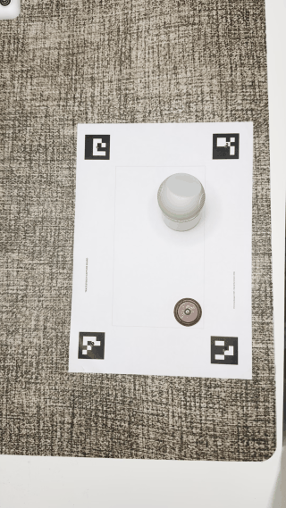
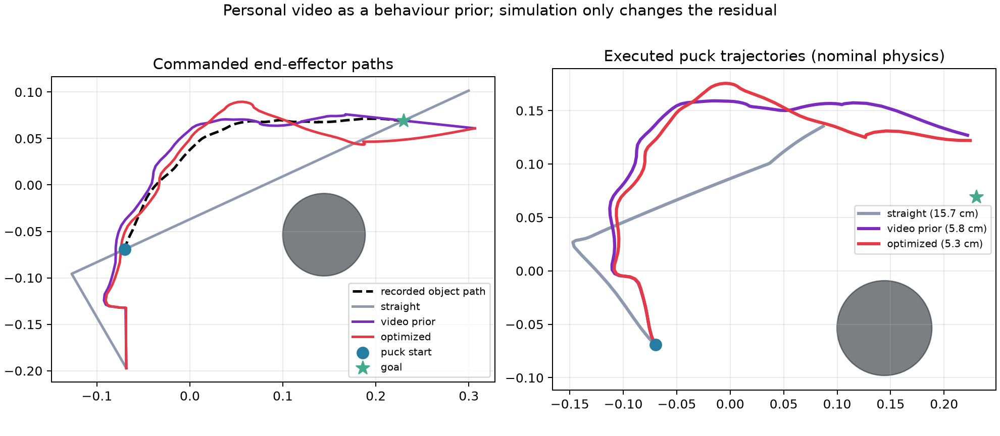
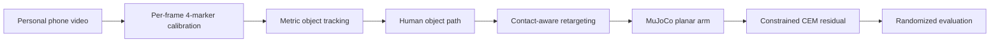

# Trace2Touch

**One personally recorded phone video becomes a collision-aware robot policy.**

Trace2Touch calibrates an overhead RGB recording, recovers the metric path of a
hand-pushed object, retargets that path to a 3-DoF planar arm in MuJoCo, then
improves it with a small residual policy found by the Cross-Entropy Method
(CEM). The recording is the behaviour prior, not an illustration: replacing
its curve with a direct start-to-goal push causes the baseline to hit the
obstacle and fail.

| Applicant-collected video and metric tracking | Retargeted MuJoCo rollout |
|---|---|
|  |  |

## Result

The primary experiment uses [`data/public/personal_demo.MOV`](data/public/personal_demo.MOV),
a 13.27 s, 1080 × 1920, 30 fps phone recording collected by the applicant. All
398 frames contain the four calibration markers and all 398 yield a valid cap
detection. The evaluation below uses 20 held-out physics/control seeds; each
changes puck mass, friction, initial pose, actuator gain, and joint damping.

| Controller | Uses personal path? | Success | Final error | Mean pusher clearance |
|---|:---:|---:|---:|---:|
| Direct start-to-goal | No | 1/20 | 14.0 ± 2.5 cm | -0.1 cm |
| Video prior | Yes | 20/20 | 5.7 ± 0.3 cm | 4.1 cm |
| Video prior + constrained CEM | Yes | **20/20** | **5.2 ± 0.3 cm** | 2.2 cm |

Success means final puck error ≤ 6.5 cm. Clearance is the minimum surface
distance between the pusher and obstacle, averaged over the evaluation seeds;
a negative value indicates contact. CEM is limited to a smooth 4 cm per-axis residual,
penalized for leaving the demonstration and for entering a 1.5 cm safety
margin. It improves final error by 8.3% without erasing the recorded route.



The causal ablation is the main result: the same arm, controller, target,
simulator, and randomized domains work with the applicant's curved path and
mostly fail when only that path shape is removed. Full per-seed results are in
[`artifacts/personal/trials.csv`](artifacts/personal/trials.csv); aggregate
metrics and provenance are in
[`artifacts/personal/metrics.json`](artifacts/personal/metrics.json).

## Method



1. **Calibrate.** Four ArUco centres define a 247 × 160 mm workspace. A
   homography is recomputed whenever all markers are visible, cancelling small
   camera movements.
2. **Track.** HSV supplies candidates, but selection also checks the measured
   16 mm object radius, circularity, board bounds, and temporal continuity. This
   prevents a similarly coloured sleeve from winning merely because it is the
   largest blob.
3. **Retarget.** The demonstrated object path is scaled into the robot
   workspace. Its local tangent places the end effector behind the puck and
   adds explicit approach and follow-through phases.
4. **Execute.** A damped least-squares inverse-kinematics controller drives a
   three-link arm in a deliberately small planar MuJoCo pushing task.
5. **Improve without replacing.** CEM searches five residual knots. The search
   is bounded, confidence-weighted, and safety-margin constrained.
6. **Test robustness.** The final comparison is repeated over 20 seeded domain
   randomizations and every rollout is retained in CSV form.

The project is intentionally CPU-only. It does not claim to be a VLA or world
model; it explores the challenge's suggested embodiment-retargeting direction
with a data-efficient geometric prior and black-box policy improvement.

## Reproduce the personal experiment

Python 3.10–3.13 is supported.

```bash
python -m venv .venv
# Linux/macOS: source .venv/bin/activate
# Windows: .venv\Scripts\activate
pip install -e ".[dev]"

trace2touch pipeline \
  --config configs/personal.yaml \
  --video data/public/personal_demo.MOV \
  --output-dir runs/personal

pytest
```

The pipeline writes the calibrated demonstration, tracking overlay, retargeted
plan, controller policies, per-seed CSV, metrics JSON, plots, report, and
rollout GIF. The committed demonstration stores SHA-256
`e6a12a9907155972615d5e0e45dcf46ebf3d3053fc088b32db35ec9b5d34b52d`,
which matches the public source video.

For a quick software-only check, run the same commands with
`configs/synthetic.yaml` after generating `data/raw/synthetic_demo.mp4` using
`trace2touch make-synthetic`. Those outputs remain separately labelled under
`artifacts/synthetic/` and are not used for the result above.

## Repository map

```text
data/public/             applicant-collected input recording
configs/personal.yaml    measured real-data experiment configuration
trace2touch/
  vision.py              calibration, robust metric tracking, provenance
  retarget.py            object-to-contact trajectory conversion
  sim.py                 MuJoCo arm, IK, controller, randomization
  optimize.py            ablation and constrained CEM residual search
  evaluate.py            seeded benchmark, plots, GIF, JSON/CSV report
artifacts/personal/       committed real-data outputs
artifacts/synthetic/      separately labelled software smoke test
tests/                    geometry, tracking, serialization, kinematics
```

## Design choices

- **Use the one demonstration efficiently.** A single video cannot identify a
  general visuomotor policy. Metric calibration and contact geometry extract a
  defensible prior; learning is restricted to a low-dimensional correction.
- **Make the personal data falsifiable.** The no-path ablation shares every
  other component. Source hashes, configuration snapshots, raw trials, and
  deterministic seeds make the data's role inspectable.
- **Keep the simulator small.** A custom MuJoCo scene installs from PyPI and
  completes on a laptop instead of hiding the idea behind a multi-gigabyte
  benchmark.
- **Separate physical and simulated embodiment.** The recorded cap is 32 mm
  wide and the obstacle base is 46 mm. The complete calibrated scene is scaled
  together before the robot contact offset is applied.

## What worked, and what did not

Four-marker calibration was reliable in every frame, including the portrait
HDR phone file. The recorded detour transferred directly and changed success
from 5% to 100%. A first largest-colour-component tracker failed on an earlier
trial because a burgundy sleeve resembled the magenta cap; adding metric size,
shape, board, and continuity checks fixed the failure and gives 100% detections
on the submitted take.

An initially loose CEM residual reduced endpoint error but nearly grazed the
obstacle and distorted the demonstrated curve. Tightening the residual to 4 cm
and adding a 1.5 cm clearance margin produced a smaller but credible gain. An
unconstrained 6-DoF puck was also rejected because rim strikes introduced
vertical solver artefacts; x/y slide joints keep this benchmark focused on
retargeting and contact planning.

This is one task from one demonstration. It does not establish general
grasping, occlusion robustness, or sim-to-real transfer. A next step would add
several objects and viewpoints, then compare this geometric prior against a
learned keypoint or VLA representation.

Licensed under MIT.
