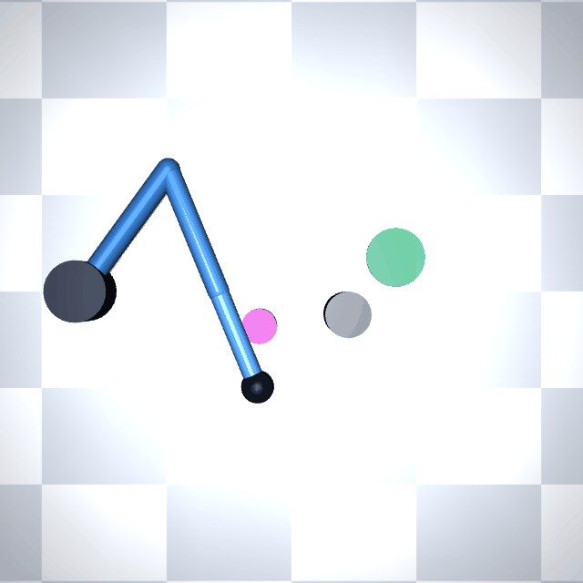
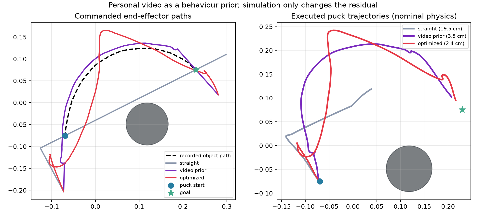
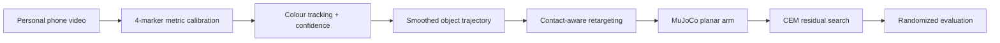

# Trace2Touch

**One personally recorded phone video becomes a collision-aware robot policy.**

Trace2Touch recovers the metric path of an object from an overhead RGB video, retargets that path to a 3-DoF planar arm in MuJoCo, and improves it with a small residual policy found by the Cross-Entropy Method (CEM). The recorded motion is not an illustration or a prompt: it is the behaviour prior. Remove its path shape and the direct controller collides with the obstacle.



> The media and numbers currently committed under `artifacts/synthetic/` are an explicitly labelled software smoke test. They verify every stage, but they are **not** claimed as applicant-collected data. See [Run it on a personal recording](#run-it-on-a-personal-recording) for the required final experiment.

## Result at a glance

The reproducible smoke test uses a perspective-warped video and ten evaluation domains. Each domain perturbs puck mass, friction, initial pose, actuator gain, and joint damping.

| Controller | Uses recorded path? | Success | Final error | Obstacle clearance |
|---|:---:|---:|---:|---:|
| Direct start-to-goal | No | 0/10 | 17.6 ± 3.3 cm | -0.1 cm |
| Video prior | Yes | 10/10 | 3.1 ± 0.6 cm | 8.1 cm |
| Video prior + CEM residual | Yes | 10/10 | **2.8 ± 0.7 cm** | 5.2 cm |

The useful result is the ablation: the same arm and controller fail when the human path is replaced by the obvious straight line. CEM gives a smaller second gain without being allowed to replace the demonstration; it can only add a smooth, bounded residual.



## Method



1. **Calibrate.** Four ArUco markers define a 247 × 160 mm workspace, so camera pose and perspective do not leak into the policy.
2. **Track.** HSV segmentation, contour quality, interpolation, and a Savitzky–Golay filter produce a timestamped metric trajectory with per-frame confidence.
3. **Retarget.** The object path is scaled into the robot workspace. Its local tangent places the end effector behind the puck, with explicit approach and follow-through phases.
4. **Execute.** A damped least-squares inverse-kinematics controller drives a 3-link arm in a planar MuJoCo pushing task.
5. **Improve, but stay close.** CEM searches five smooth residual knots. High-confidence video segments receive a stronger imitation penalty; endpoints remain fixed.
6. **Test robustness.** Evaluation runs use held-out physics and control perturbations, and write every seed to CSV.

The whole experiment runs on CPU. There is no pretrained detector, cloud API, hidden checkpoint, or simulator download.

## Reproduce the committed smoke test

Python 3.10–3.13 is supported.

```bash
python -m venv .venv
# Linux/macOS: source .venv/bin/activate
# Windows: .venv\Scripts\activate
pip install -e ".[dev]"

trace2touch make-synthetic \
  --config configs/synthetic.yaml \
  --output data/raw/synthetic_demo.mp4

trace2touch pipeline \
  --config configs/synthetic.yaml \
  --video data/raw/synthetic_demo.mp4 \
  --output-dir runs/synthetic

pytest
```

Expected runtime is about 20 seconds on a laptop CPU. The pipeline writes the calibrated `.npz`, tracking overlay, controller policies, per-seed CSV, metrics JSON, plots, report, and rollout GIF.

## Run it on a personal recording

The challenge constraint is intentionally enforced as a provenance step rather than hidden in the code.

1. Print [`artifacts/capture_board.pdf`](artifacts/capture_board.pdf) on A4 landscape paper at **100% scale**.
2. Put a vivid magenta object (a bottle cap works) near marker 3. If using the supplied obstacle configuration, put an obstacle at the measured board coordinate in the YAML.
3. Fix the phone above the page with all four markers visible. Record 10–20 seconds: pause, personally push the object around the obstacle to the opposite side, then pause again.
4. Copy `configs/personal.template.yaml` to `configs/personal.yaml`. Fill in `collected_by`, `collection_date`, and `notes`; adjust the HSV range or obstacle measurement if needed.
5. Run:

```bash
trace2touch pipeline \
  --config configs/personal.yaml \
  --video data/raw/my_push.mp4 \
  --output-dir runs/personal
```

Before publishing, inspect `tracking_overlay.gif`, confirm the puck is tracked rather than a similarly coloured distractor, and copy only the intended public outputs into `artifacts/personal/`. Raw videos are ignored by Git because a public application repository should not accidentally expose faces, voices, or room details. The derived demonstration retains the source video's SHA-256 digest, collection metadata, calibration, and detection coverage.

More detail is in [the capture protocol](docs/CAPTURE.md) and [the data card](docs/DATA_CARD.md).

## Repository map

```text
trace2touch/
  board.py       printable calibration board
  vision.py      marker calibration, tracking, smoothing, provenance
  retarget.py    object-to-contact trajectory conversion
  sim.py         MuJoCo model, IK, controller, domain randomization
  optimize.py    straight-line ablation and confidence-weighted CEM
  evaluate.py    seeded benchmark, plots, GIF, JSON/CSV report
configs/         synthetic reference and personal-data template
tests/           geometry, serialization, and kinematics tests
artifacts/       capture board and reproducible example outputs
```

## Design choices

- **A deliberately small simulator.** LIBERO would add several gigabytes and obscure the part being tested. The custom MuJoCo scene installs from PyPI and finishes a robust benchmark in seconds.
- **Geometry before learning.** One short video cannot identify a general visuomotor policy. Metric calibration and contact geometry use the data efficiently; learning is restricted to a low-dimensional residual.
- **Confidence has a job.** Detection confidence weights the demonstration-preservation term, so CEM can change uncertain/occluded regions more than clean observations.
- **The ablation shares everything else.** The direct baseline uses the same arm, controller, timing, and randomized domains. Only the recorded path shape is removed.
- **Planar puck dynamics.** The puck has x/y slide joints so the experiment isolates retargeting and contact planning instead of rewarding accidental 3-D tipping.

## What worked, and what did not

The four-marker board made the vision stage insensitive to the synthetic camera warp, and simple colour tracking was sufficient for a deliberately controlled capture setup. The largest performance change came from retaining the demonstrated curve; CEM's improvement was real but modest (3.1 cm to 2.8 cm), which is more informative than overselling it.

An unconstrained 6-DoF puck was tried first. A stiff position controller could strike its rim and inject vertical energy, making results depend on solver details rather than the proposed method. Restricting the benchmark to planar motion removed that failure mode. This project therefore does **not** claim general grasping, occlusion robustness, or sim-to-real transfer. A next step would replace colour tracking with hand/object keypoints and train the residual across multiple personally collected demonstrations.

## Reproducibility

- All random number generators use explicit seeds.
- Every trial is stored in `trials.csv`; aggregate values are derived from those rows.
- The source recording is content-addressed by SHA-256 inside `demonstration.npz` and `metrics.json`.
- Synthetic data carries `synthetic: true` through extraction and reporting, preventing it from being silently presented as a personal recording.
- CI installs the package from scratch and runs the unit tests on Python 3.11.

Licensed under MIT.
